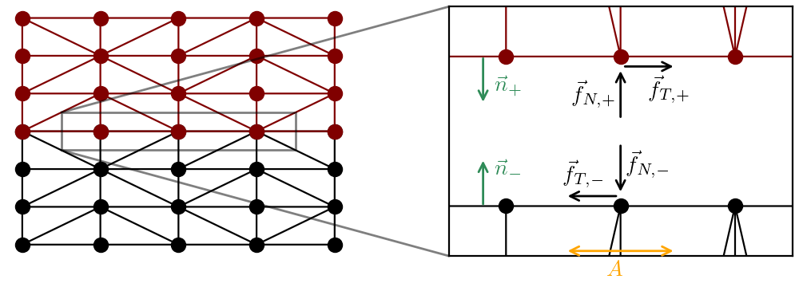

.. _sect-ntn:

Node To Node Contact
--------------------

The node to node (NTN) contact model handles the interaction between two contacting surfaces, the bodies in contact being described by a :cpp:class:`SolidMechanicsModel <akantu::SolidMechanicsModel>`.

Using the Node To Node Contact Model
````````````````````````````````````

To use the node to node contact, a dedicated coupler class :cpp:class:`NTNContactSolverCallback <akantu::NTNContactSolverCallback>` is provided.

To instantiate a coupler object, one needs to pass a solid mechanics model object :cpp:class:`SolidMechanicsModel<akantu::SolidMechanicsModel>`, the ID of the geometrical boundaries constituting the two sides of the interface, the orientation of the normal surface and the time step factor to be used in the dynamic computation. A schematic showing the interfaces between two meshes (bottom one in black, top one in brown) is shown in :numref:`fig:ntn:schematic`. The coupler applies opposite forces on the matching nodes and couple the two surfaces together. The interfacial forces are limited by the chosen constitutive behavior (see :ref:`sect-ntn-laws`) such that displacement discontinuities can develop between the two surfaces.

.. code-block:: c++

		NTNContactSolverCallback coupler(solid,slave,master,surface_nor_dir,time_step)
		


   Contact interface between two bodies. The bottom (black, -) and top (brown, +) have matching nodes on the contacting surfaces of normal :math:`\vec{n}_{\pm}`. Normal :math:`\vec{f}_{\mathrm N,\pm}` and frictional forces :math:`\vec{f}_{\mathrm T,\pm}` are applied on the matching nodes, whose area of influence is indicated by :math:`A`.

Implementation
``````````````
   
The residual on nodes part of the contact interface can be written as :

.. math::      
   :label: eq_ntn_residual

   \ddot{\vec{u}}^{i} = \ddot{\vec{\delta u}}^{i} + \ddot{\vec{u}}^{i} = {\mat{M}}^{-1} \left(\vec{f}_{\mathrm{ext}}^{i} - \vec{f}_{\mathrm{int}}^{i} + \vec{f}_{\mathrm{N}}^{i} + \vec{f}_{\mathrm{T}}^{i} \right)
       
with :math:`\vec{f}_{\mathrm{N}}` and :math:`\vec{f}_{\mathrm{T}}` respectively the contact and the frictional forces at the contact interface. Note that they are zero for any nodes that are not on the interface.

Contact forces
''''''''''''''

The contact forces are computed based on a non overlapping condition in the normal direction:

.. math::
   :label: eq_ntn_gap
	   
   [\![\vec{x}]\!]_{\rm N}^{i+1} \geq 0

where :math:`[\![\vec{x}]\!]` indicates the difference between the jump in fields between the nodal position :math:`x` of the node in the top body and its matching node in the bottom body, and the subscript :math:`\rm N` the normal direction. The non overlapping condition can be expressed as:

.. math::
    [\![\vec{x}]\!]_{\rm N}^{i+1} = [\![\vec{x}]\!]_{\rm N} + [\![\vec{u}]\!]_{\rm N}^{i+1} \geq 0

The gap in displacement :math:`[\![\vec{u}]\!]_{\rm N}^{\rm i+2}` can be expressed as the gap in the fields at the previous time step:

.. math::
   [\![\vec{x}]\!]_{\rm N} + [\![\vec{u}]\!]_{\rm N}^{i} + \Delta t [\![\dot{\vec{u}}]\!]_{\rm N}^{i} + \frac{1}{2}(\Delta t)^2  [\![\ddot{\vec{u}}]\!]_{\rm N}^{i} \geq 0

Replacing the velocity by its expression based on the predicted velocity and the acceleration increment, one gets

.. math::
    [\![\vec{x}]\!]_{\rm N} + [\![\vec{u}]\!]_{\rm N}^{i} + \Delta t [\![\dot{\vec{u}}^P]\!]_{\rm N}^{i} + \frac{1}{2}(\Delta t)^2 \left( [\![\ddot{\vec{\delta u}}]\!]_{\rm N}^{i} +  [\![\ddot{\vec{u}}]\!]_{\rm N}^{i} \right) \geq 0

Replacing :math:`[\![\ddot{\vec{\delta u}}]\!]_{\rm N}^{i}` by :math:`[\![\ddot{\vec{u}}]\!]_{\rm N}^{i} - [\![\ddot{\vec{u}}]\!]_{\rm N}^{i-1}`, and using :eq:`eq_ntn_residual` results in:

.. math::
   :label: eq_ntn_contact

   [\![\vec{x}]\!]_{\rm N} + [\![\vec{u}]\!]_{\rm N}^{i} + \Delta t [\![\dot{\vec{u}}^P]\!]_{\rm N}^{i} - \frac{\Delta t^2}{2}[\![\ddot{\vec{u}}]\!]_{\rm N}^{\rm n} + \Delta t^2 \mat{M}^{-1} \left([\![\vec{f}_{\mathrm{ext}}]\!]^{i} - [\![\vec{f}_{\mathrm{int}}]\!]^{i} + [\![\vec{F}]\!]_{\rm N}^{i} \right) \geq 0
       
Let us define :math:`[\![\ddot{\vec{u}}^{free}]\!]_{\rm N}^{i} = \mat{M}^{-1} \left([\![\vec{f}_{\mathrm{ext}}]\!]^{i} - [\![\vec{f}_{\mathrm{int}}]\!]^{i} \right)` the acceleration related to the residual of the bodies that are not related by the node to node algorithm. The contact forces can be written as :math:`[\![\vec{f}]\!]_{\rm N}^{i} = \vec{A} [\![\vec{T}]\!]_{\rm N}^{i}` with :math:`\vec{A}` the area associated to the contact nodes, and :math:`\vec{T}_{\rm N}^{\rm i}` the contact stress. As the stress on the top and bottom matching nodes are equal and opposites, one can replace :math:`[\![\vec{T}]\!]_{\rm N}^{i}` by :math:`-2\vec{T}_{\rm N}^{i}`. Let us introduce the variable :math:`\vec{Z}` :

.. math::
    \vec{Z}^{-1} = \frac{\Delta t}{2} \left( \mat{M}^{-1}_+ \vec{A}_{+} + \mat{M}^{-1}_{-} \vec{A}_{-} \right)

We can then simplify :eq:`eq_ntn_contact` as:

.. math::
   :label: eq_ntn_contact_final
   
   [\![\vec{x}]\!]_{\rm N} + [\![\vec{u}]\!]_{\rm N}^{i} + \Delta t [\![\dot{\vec{u}}^P]\!]_{\rm N}^{i} - \frac{\Delta t^2}{2} [\![\ddot{\vec{u}}]\!]_{\rm N}^{i-1} + \Delta t^2 [\![\ddot{\vec{u}}^{free}]\!]_{\rm N}^{i} - 2 \Delta t \vec{Z}^{-1} \vec{T}_{\rm N}^{i} \geq 0

In :eq:`eq_ntn_contact_final` all the terms except one are independent of the node to node algorithm. Let us introduce a last variable :math:`I^{free}`, that we call here the interpenetration of the free bodies:

.. math::
    {\vec{I}^{free}}^{i} = [\![\vec{x}]\!]_{\rm N} + [\![\vec{u}]\!]_{\rm N}^{\rm i} + \Delta t [\![\dot{\vec{u}}^P]\!]_{\rm N}^{i} - \frac{\Delta t^2}{2} [\![\ddot{\vec{u}}]\!]_{\rm N}^{i-1} + (\Delta t^2 [\![\ddot{\vec{u}}^{free}]\!]_{\rm N}^{i}).

Then, if :math:`{\vec{I}^{free}}^{i} \geq 0`, it means that there is no need for corrective contact stress to forbid interpenetration, and thus :math:`\vec{T}_{\rm N}^{i}=0`. However, if :math:`{\vec{I}^{free}}^{i} \leq 0`, then the contact stresses need to be computed as:

.. math::
   \vec{T}_{\rm N}^{i} = \frac{\vec{Z} {\vec{I}^{free}}^{i}}{2 \Delta t} ,

and the forces are then applied on the nodes as:

.. math::
    \vec{f}_{\rm N}^{i} = \vec{A} \vec{T}_{\rm N}^{i} .
    
Friction forces
'''''''''''''''

For the tangential (friction) forces, a similar derivation is done, but this time starting with a condition on the relative velocity in the tangential direction of the matching nodes at the mid-time step. This first condition assumes that the friction forces are sufficient to hold the body together and thus there is no gap in velocity:

.. math::
    [\![\dot{\vec{u}}]\!]_{\rm T}^{i+1/2} = 0

The velocity at the mid-time step is given by :math:`\dot{\vec{u}}_{\rm T}^{i+1/2} = \dot{\vec{u}}_{\rm T}^{i} + \ddot{\vec{u}}_{\rm T}^{i} \Delta t /2`. Thus, we can write:

.. math::
    [\![\dot{\vec{u}}]\!]_{\rm T}^{i}+\frac{\Delta t}{2}\left([\![\ddot{\vec{\delta u}}]\!]_{\rm T}^{i}+[\![\ddot{\vec{u}}]\!]_{\rm T}^{i}\right)=0

Defining :math:`[\![\vec{f}]\!]_{\rm T}^{i} = \vec{A} [\![\vec{T}]\!]_{\rm T}^{i}` and using the argument that the frictional stresses are equal and opposite :math:`[\![\vec{T}]\!]_{\rm T}^{i}` by :math:`-2\vec{T}_{\rm T}^{i}`, we can write:

.. math::
    [\![\dot{\vec{u}}^P]\!]_{\rm T}^{i} - \frac{\Delta t}{2} [\![\ddot{\vec{u}}]\!]_{\rm T}^{i-1} + \Delta t [\![\ddot{\vec{u}}^{free}]\!]_{\rm T}^{i} - 2\vec{Z}^{-1} \vec{T}_{\rm T}^{i} .

Similarly to the case of contact forces, let us introduce :math:`\vec{R}^{free}` as:

.. math::
    {\vec{R}^{free}}^{i} = [\![\dot{\vec{u}}^P]\!]_{\rm T}^{i} - \frac{\Delta t}{2} [\![\ddot{\vec{u}}]\!]_{\rm T}^{i-1} + \Delta t [\![\ddot{\vec{u}}^{free}]\!]_{\rm T}^{i} .

The tangential stress required to forbid any relative movement between two matching nodes is then given by:

.. math::
    \vec{T}_{\rm T}^{i} = \frac{\vec{Z} {\vec{R}^{free}}^{i}}{2} .

and the corresponding force applied on the nodes:

.. math::
    \vec{f}_{\rm T}^{i} = \vec{A} \vec{T}_{\rm T}^{i} .

The constitutive behavior of the frictional interfaces determines if these forces are applied in full or not, depending on the frictional strength of the interface :math:`\vec{S}_{\rm T}^{i}`, the forces added to the residual being given by :math:`\vec{A} min(\vec{T}_{\rm T},\vec{S}_{\rm T})`. The constitutive behavior currently implemented in akantu are described in the next section.

.. _sect-ntn-laws:

Interfacial constitutive behavior
`````````````````````````````````

Friction laws
'''''''''''''

Rate and state
""""""""""""""

.. math::
    \vec{S} =  \vec{f}_{\rm N} \mu(v,\phi) ,

in which :math:`\mu(v,\phi)` is the friction coefficient given by a rate and state friction formulation and :math:`\phi` is the state variable representing the age of contact. The velocity used to evaluate :math:`\mu` is the relative velocity between the two surfaces, :math:`v = [\![\dot{\vec{u}}]\!]_{\rm T}`.

For rate and state friction, the time step have to be significantly reduced compared to regular bulk finite element simulations, see :cite:`rezakhani2020`. For the typical simulations with node to node contact described by rate and state friction laws, the safety factor for the time step should be around :math:`\alpha_{\rm F} = \mathcal{O}(0.01)`.

The updated explicit scheme relies on adding both the contact and the frictional forces :math:`\vec{f}_{\rm N}^{i}` and :math:`\vec{f}_{\rm T}^{i}` when the residual is evaluated, by using :eq:`eq_ntn_residual` to compute the acceleration increment.

Rate evolution laws
^^^^^^^^^^^^^^^^^^^^^^^^

Dieterich law
+++++++++++++

A "+1" term is added inside the log of velocity to avoid NaN values when the velocity tends toward 0.

.. math::
  \mu = \mu_0 + a \ln \left(\frac{|v|}{v^*}\right) + b\ln \left(\frac{\phi}{\phi^*}\right)


Revised Dieterich law
+++++++++++++++++++++

A "+1" term is added inside the log of velocity to avoid NaN values when the velocity tends toward 0. Note the :math:`b \mu_0` to have a coherent shape with the N-shaped law.

.. math::
  \mu = \mu_0 + a \ln \left(1 + \frac{|v|}{v^*}\right) + b\mu_0\ln \left(\frac{\phi}{\phi^*}\right)

Regularised Dieterich law
+++++++++++++++++++++++++

A "+1" term is added inside the log of velocity to avoid NaN values when the velocity tends toward 0.

.. math::
  \mu = \mu_0 + a \ln \left(1 + \frac{|v|}{v^*}\right) + b\mu_0\ln \left(1 + \frac{\phi}{\phi^*}\right)

N-shaped law
++++++++++++

The N-shaped law features rate-weakening at intermediate velocities and a strengthening behavior at really low and high sliding velocities. The "+1" term in the logarithm of the state leads to the existence of a velocity-strengthening branch at large velocity. 

.. math::
  \mu = \left[1 + b \ln \left(1 + \frac{\phi}{\phi^*} \right)\right] \left[\frac{\mu_0}{\sqrt{1 + (v^*/v)^2}} + a \ln \left(\frac{|v|}{v^*}\right)\right]

Revised N-shaped law
++++++++++++++++++++

The N-shaped law features rate-weakening at intermediate velocities and a strengthening behavior at really low and high sliding velocities.
The "+1" term in the logarithm of the velocity and the function :math:`\sqrt{1 + (v^*/v)^2}` ensures that the friction coefficient vanishes for :math:`v=0` and that the behavior at very small velocity is rate-strengthening (this regime is related to the creep of microcontacts). The "+1" term in the logarithm of the state leads to the existence of a velocity-strengthening branch at large velocity. 

.. math::
  \mu = \left[1 + b \ln \left(1 + \frac{\phi}{\phi^*} \right)\right] \left[\frac{\mu_0}{\sqrt{1 + (v^*/v)^2}} + a \ln \left(1 + \frac{|v|}{v^*}\right)\right]

State evolution laws
^^^^^^^^^^^^^^^^^^^^

Ageing state law
****************

.. math::
  \partial_t \phi = 1 - \frac{|v| \phi}{D_c}

Slip state law
***************

.. math::
  \partial_t \phi = - \frac{|v| \phi}{D_c} \ln \left(\frac{|v| \phi}{D_c}\right)

Ageing Regularized state law
*****************************

.. math::
  \partial_t \phi = 1 - \frac{\phi}{D_c} \sqrt{v^2 + v_0^2}

Note that :math:`v_0` is usually set equal to :math:`v^*`. 